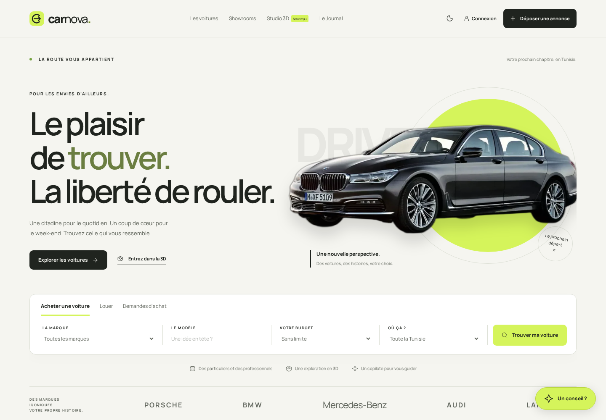
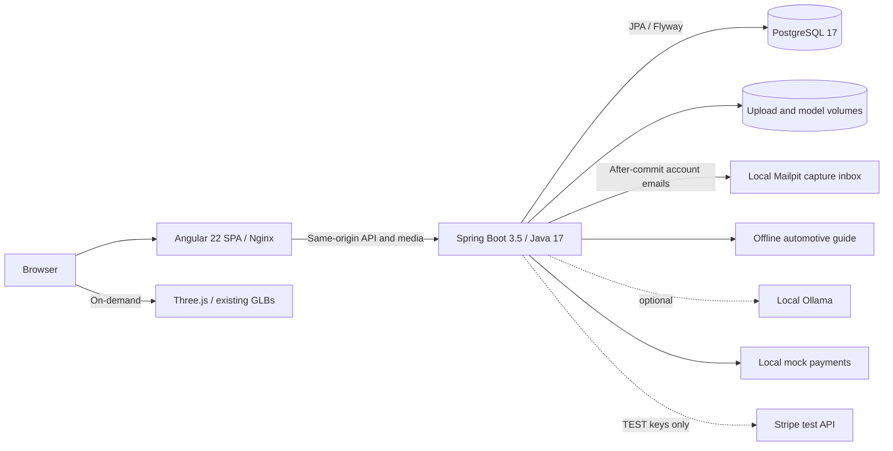
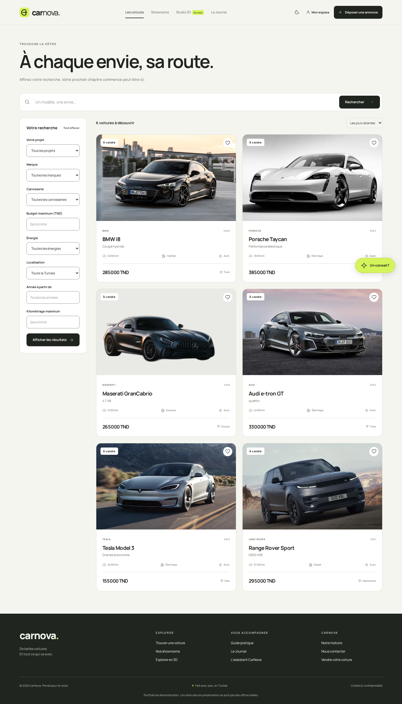
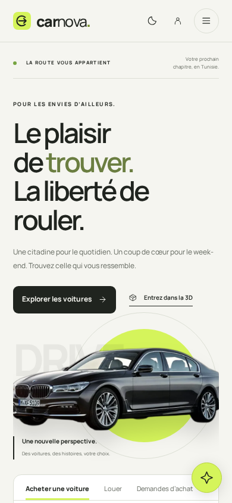
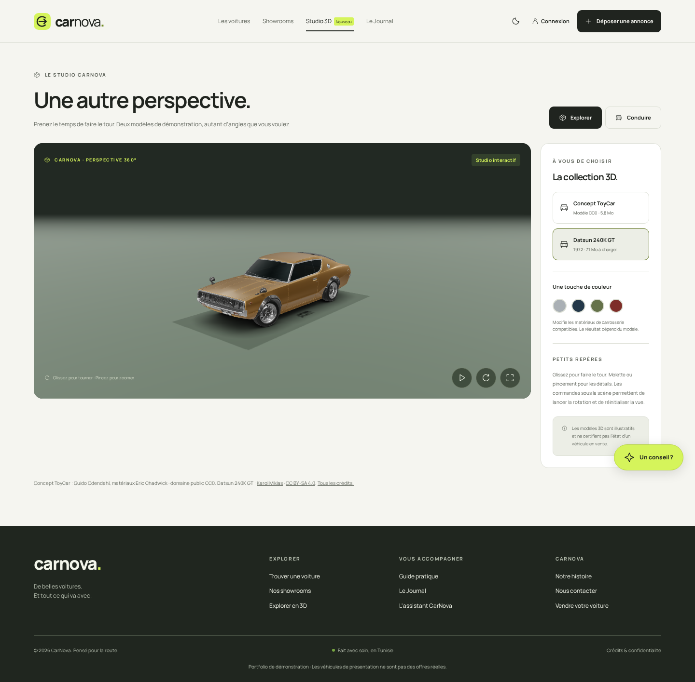
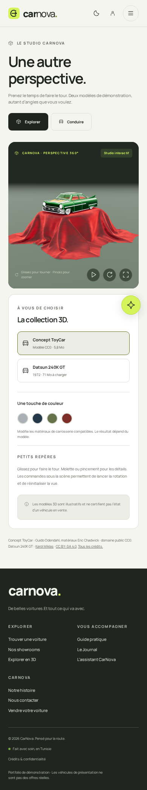

# CarNova

**Le plaisir de trouver. La liberté de rouler.**

A French-first automotive marketplace for Tunisia, rebuilt with Angular 22 and Spring Boot 3.5. Explore listings, publish a car, create a showroom, inspect demonstration models in 3D, and prepare your next move with the CarNova assistant.



## Run the whole platform

With Docker and Docker Compose available, from the repository root:

```bash
docker compose up --build --wait
```

- **Platform:** http://localhost:8080
- **Account capture inbox:** http://localhost:8025 (local test emails)
- **API health:** http://localhost:8081/actuator/health
- **Swagger UI:** http://localhost:8081/swagger-ui.html
- **OpenAPI schema:** http://localhost:8081/v3/api-docs

The default configuration is a **local portfolio demo** bound to localhost. It creates a separate PostgreSQL database, six clearly identified sample listings, a showroom and original editorial content. Payments are local simulations and the assistant works without an external account or paid API.

Create a user through **Connexion → Créer mon compte**. To review the admin dashboard in a fresh default demo, use `admin@carnova.local` with the public local-demo password `portfolio-admin-demo-only`. Override `DEMO_ADMIN_PASSWORD` before first startup if desired. The demo administrator is created only on an empty database; there is no public admin-signup route.

```bash
# Optional local configuration; replace the placeholders before using this file.
cp .env.example .env

# Stop services while preserving their data.
docker compose down
```

The original `carnova-back/uploads/` and `models/` folders remain intact. New container uploads, models and PostgreSQL data live in separate named volumes. Existing database adoption is an explicit, reviewed procedure in [docs/DATABASE.md](docs/DATABASE.md).

## Live demo hosting

The public demo runs for free on Render (one Docker service built from the root `Dockerfile`) with its database on Neon. Setup, limits and the reasons behind each setting: [docs/DEPLOY.md](docs/DEPLOY.md).

## Account essentials

Open **Mon espace → Mon compte** to edit your name, confirm your email, or change your password. **Mot de passe oublié ?** on sign-in starts recovery. Signup sends a verification link to the local capture inbox; reset links arrive there too. Existing users can keep signing in. Successful password changes/resets close every old session.

The portfolio uses a local Mailpit inbox and sends no external email. [Account setup, API, security decisions and current checks](docs/ACCOUNTS.md) explain the flow. Set `FRONTEND_URL` to the browser origin when changing ports or using Angular's dev server.

## What is here

- Searchable, filterable listings with shareable URLs, sort and pagination; galleries, seller contact, favorites and related cars.
- A four-step publishing wizard with validated specs, photo upload, optional GLB attachment, review and mock/Stripe TEST checkout. Owner-only edits, availability status and deletion.
- Public showroom collections with owner creation and editing, photos and vehicle inventories.
- A deferred Three.js studio with orbit, paint controls, progress, fullscreen, static fallback and a driving sandbox with keyboard/touch controls. Large original models load only after selection.
- A keyboard-accessible assistant dialog: transparent offline automotive guidance by default, optional user-managed local Ollama.
- Original Journal content, optional admin-triggered fixed-source RSS refresh, practical guides, about and a working contact inbox.
- An administrator dashboard with actual counts, six-month charts, recent listings, editorial publishing and contact messages.
- An original graphite, paper and chartreuse design system, light/dark mode, local Manrope font, responsive layouts, visible focus and reduced-motion support.

## Architecture



Angular uses standalone components, signals, typed reactive forms, functional guards/interceptors and lazy routes. Tailwind 4 and semantic CSS variables provide the design foundation. The API validates DTOs, issues expiring HMAC JWTs, assigns roles server-side, checks ownership, hashes passwords with BCrypt and confines media access. Flyway owns schema changes; Hibernate validates them.

Security and compatibility decisions are in [docs/DECISIONS.md](docs/DECISIONS.md); the endpoint inventory is in [docs/API.md](docs/API.md). The original audit and phased plan remain in [docs/AUDIT.md](docs/AUDIT.md) and [docs/PLAN.md](docs/PLAN.md).

## Local development

Requirements: Node **22.22.3+ on the 22.x line** (22.23.1 verified), Java 17+, Maven and PostgreSQL. Angular 22 currently requires TypeScript 6; the lockfile pins compatible versions.

```bash
cd carnova-front
npm ci
npm start
```

The development server at http://localhost:4200 proxies `/api` and `/uploads` to port 8081. All browser API calls use relative URLs.

For a local backend, create a fresh PostgreSQL database, set the variables from `.env.example` in your shell, then:

```bash
cd carnova-back
mvn spring-boot:run
```

At minimum, set `DATABASE_URL`, `DATABASE_USER`, `DATABASE_PASSWORD` and `JWT_SECRET` (at least 32 bytes). Spring Boot does not automatically load a root `.env` when launched with Maven; export the values explicitly. `DEMO_DATA` defaults to false outside Compose.

Useful frontend commands:

```bash
npm test                # Unit tests
npm run build           # Production build with bundle budgets
npm run format:check    # TypeScript, Angular templates, CSS and test formatting
npm run assets:optimize # Reproduce optimized assets from existing repository images
npx playwright install chromium
npm run test:e2e        # Run against the healthy Compose stack
npm run test:a11y       # Desktop/mobile and dark-mode accessibility checks
npm run test:visual     # Refresh portfolio screenshots
npm run lighthouse     # Mobile Lighthouse report against localhost:8080
```

The backend integration suite uses an isolated H2 database in PostgreSQL mode, runs the real migrations and Spring Security, and makes no paid network request:

```bash
mvn -B -ntp -f carnova-back/pom.xml verify
```

Docker also builds and runs the backend tests on Java 17. CI builds/tests both applications and runs Chromium workflows against the full PostgreSQL stack. Actions are pinned to reviewed upstream release commit hashes.

## Optional integrations

**Payments:** `PAYMENTS_MODE=mock` is the default. For an existing Stripe test account, set `PAYMENTS_MODE=test`, `STRIPE_SECRET_KEY=sk_test_…` and `STRIPE_PUBLISHABLE_KEY=pk_test_…`. Live keys are rejected. The server fixes the fee at €5 and checks ownership, provider status, amount, currency and metadata before accepting confirmation. Listing prices remain TND. No real-payment mode is implemented.

**Local assistant:** set `OLLAMA_URL` to a reachable, user-managed local Ollama server and `OLLAMA_MODEL` to an installed model. Blank configuration provides the offline guide. Requests time out and fall back to the guide; the UI identifies the active provider. No hosted model account is needed.

## Review and evidence

The latest [account milestone](docs/ACCOUNTS.md) records 43 passing frontend tests, 34 passing backend account tests and the production build. The earlier [follow-up review](docs/FOLLOWUP_REVIEW.md) records the search/detail fixes. Both separate current offline checks from historical Docker/browser/Lighthouse evidence. Fresh database/browser verification and publication remain pending access.

Start with the landing page, a listing, the publishing wizard and the 3D studio. Then open the administrator view to inspect actual metrics and the inbox. [PROGRESS.md](PROGRESS.md) records completed phases and remaining limits; [docs/VERIFICATION.md](docs/VERIFICATION.md) records measured checks.

| Desktop | Mobile |
| --- | --- |
|  |  |
|  |  |

More desktop/mobile captures are in [docs/screenshots](docs/screenshots). A locally generated [Lighthouse report](docs/reports/lighthouse-mobile.html) and [machine-readable summary](docs/reports/lighthouse-summary.json) accompany the verification notes. Scores describe this local run, rather than a production service guarantee.

## Assets and practical limits

Existing repository images were optimized into ~548 KB of responsive WebP content; no design or new image was copied from another website. Original asset folders are preserved. The 71 MB Datsun is intentionally optional; the default studio model is ~5.8 MB. Files historically named `bmw.glb` and `mercedes.glb` contain the same **CC0 ToyCar** by Guido Odendahl, with materials by Eric Chadwick. The studio labels it correctly. The Datsun model is by [Karol Miklas](https://sketchfab.com/3d-models/free-1972-datsun-240k-gt-b2303a552b444e5b8637fdf5169b41cb), under [CC BY-SA 4.0](https://creativecommons.org/licenses/by-sa/4.0/). Original photographs retain their existing provenance; this project does not grant a new commercial asset license. Manrope uses the SIL Open Font License.

Historical embedded credentials were removed from working configuration and logs are excluded from version control. Their owner must rotate previously exposed credentials; history was intentionally not rewritten. This portfolio configuration has no password-reset/email delivery service, real-payment mode or cloud deployment. See [docs/BLOCKERS.md](docs/BLOCKERS.md) for environment-specific limitations.
